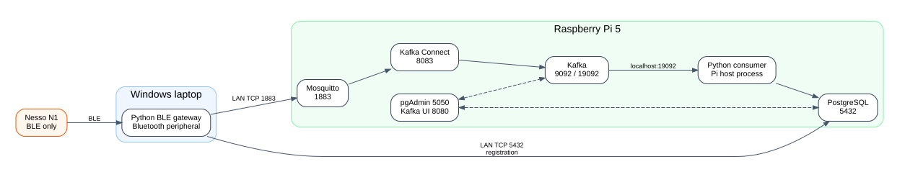

# Deployment topology

## Recommended split

### Windows laptop

Runs:

- patched Python virtual environment;
- `n1_registration_server.py`;
- Bluetooth adapter connected to the Nesso;
- network connection to the Pi on ports 1883 and 5432.

### Raspberry Pi 5

Runs:

- Docker Engine and Compose;
- PostgreSQL and pgAdmin;
- Mosquitto;
- Kafka and Kafka UI;
- Kafka Connect with the MQTT Source Connector;
- `detection/kafka_to_postgres.py` as a host Python process.

### Nesso N1

Requires only power and BLE proximity to the gateway. The active firmware does not require Wi-Fi credentials.

## Published ports

| Port | Service | Intended access |
|---:|---|---|
| 1883 | Mosquitto | Laptop gateway and local tools |
| 5432 | PostgreSQL | Laptop registration gateway and Pi consumer |
| 5050 | pgAdmin | Browser administration |
| 8080 | Kafka UI | Browser inspection |
| 8083 | Kafka Connect REST | Connector registration and status |
| 9092 | Kafka internal listener | Docker network |
| 19092 | Kafka external listener | Pi host consumer |

## Docker networks

The Compose files create separate project networks. Kafka Connect joins both its default Kafka network and `bridge_network`, allowing it to resolve:

- `kafka:9092`;
- `mosquitto:1883`.

## Network assumptions

The laptop and Pi must be on a LAN that allows peer-to-peer traffic. Client-isolating school Wi-Fi may block MQTT or PostgreSQL even when both devices appear connected. A private router or phone hotspot is the simplest controlled test network.

## Kafka listener constraint

The broker currently advertises `EXTERNAL://localhost:19092`. Therefore the host Kafka consumer should run on the Pi. A consumer on another machine would be told to connect to its own `localhost`, which would fail unless advertised listeners are reconfigured.
